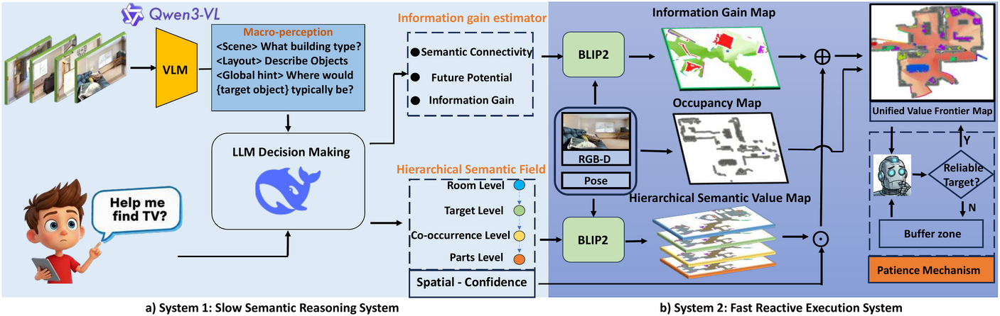

# InfoNav

**A Unified Value Framework Integrating Semantic Relevance and Information Gain for Zero-Shot Object Goal Navigation**

[](https://neurips.cc/virtual/2026/poster/149947)
[](https://openreview.net/forum?id=lzhhlAlmjK)
[](LICENSE)
[](pyproject.toml)
[](https://wiki.ros.org/noetic)

InfoNav was accepted to **NeurIPS 2026**. It formulates zero-shot ObjectNav as unified value estimation over frontier candidates by combining a hierarchical semantic value map, visual-semantic information gain, and memory-augmented verification.

**Authors:** [Zhi Yang](https://github.com/Pandakingxbc), Chengpu Yu, and Gonzalo Ferrer.

[[Paper / OpenReview](https://openreview.net/forum?id=lzhhlAlmjK)]
[[NeurIPS page](https://neurips.cc/virtual/2026/poster/149947)]
[[Demo video](https://github.com/Pandakingxbc/InfoNav/releases/download/v1.0.0-demo/InfoNav.mp4)]
[[Reproducibility guide](docs/REPRODUCIBILITY.md)]



## Results

The NeurIPS 2026 paper reports the following zero-shot ObjectNav results:

| Benchmark | Success rate |
| --- | ---: |
| HM3D-v1 | 62.0% |
| HM3D-v2 | 81.5% |
| MP3D | 41.8% |

Please consult the paper for the complete protocol, SPL, ablations, and comparisons. The repository records the exact runtime configuration and Git revision alongside long evaluation runs; see the [reproducibility guide](docs/REPRODUCIBILITY.md).

## Method

InfoNav integrates:

- a hierarchical semantic value map (HSVM) that models spatially weighted object, part, co-occurrence, and room cues;
- an information-gain estimator grounded in visual-semantic connectivity;
- adaptive fusion of semantic relevance and information gain;
- weighted traveling repairman (WTRP) frontier scheduling; and
- memory-augmented verification with time-varying confidence thresholds.

The system uses Habitat for simulation and ROS for communication between the simulator, perception services, mapping, and exploration planner.

## Requirements

- Ubuntu 20.04
- ROS Noetic
- Python 3.9 (the provided environment is pinned to Python 3.9)
- NVIDIA GPU with CUDA support; the authors tested on an RTX 4070 Ti
- `conda`, `git`, `git-lfs`, `tmux`, and `catkin_tools`

Scene datasets and model weights are not redistributed in this repository. Review their upstream licenses and access conditions before downloading them.

## Installation

### 1. Clone InfoNav and its pinned D-FINE submodule

```bash
git clone --recurse-submodules https://github.com/Pandakingxbc/InfoNav.git
cd InfoNav
```

If the repository was cloned without submodules:

```bash
git submodule update --init --recursive
```

### 2. Install system dependencies

```bash
sudo apt update
sudo apt install -y git-lfs tmux libarmadillo-dev libompl-dev
```

Install [ROS Noetic](https://wiki.ros.org/noetic/Installation/Ubuntu) and `catkin_tools` before building the workspace.

### 3. Create the Python environment

```bash
conda env create -f infonav_environment.yaml
conda activate infonav
```

Install the PyTorch build matching your CUDA runtime. For example, for CUDA 12.1:

```bash
pip install torch==2.5.0 torchvision==0.20.0 torchaudio==2.5.0 \
  --index-url https://download.pytorch.org/whl/cu121
```

CUDA 11.8 and 12.4 wheels can be selected by replacing `cu121` with `cu118` or `cu124`.

### 4. Install Habitat and external perception code

```bash
git clone https://github.com/facebookresearch/habitat-lab.git
git -C habitat-lab checkout v0.3.1
pip install -e habitat-lab/habitat-lab
pip install -e habitat-lab/habitat-baselines

git clone https://github.com/IDEA-Research/GroundingDINO.git
git -C GroundingDINO checkout 856dde20aee659246248e20734ef9ba5214f5e44

git clone https://github.com/WongKinYiu/yolov7.git
git -C yolov7 checkout a207844b1ce82d204ab36d87d496728d3d2348e7

pip install -r vlm/detector/D-FINE/requirements.txt
pip install salesforce-lavis==1.0.2
pip install -e .
```

### 5. Download checkpoints

Create the expected directories:

```bash
mkdir -p data pretrained_weights
```

| File | Destination | Source |
| --- | --- | --- |
| MobileSAM `mobile_sam.pt` | `data/mobile_sam.pt` | [MobileSAM weights](https://github.com/ChaoningZhang/MobileSAM/tree/master/weights) |
| GroundingDINO Swin-T OGC | `data/groundingdino_swint_ogc.pth` | [GroundingDINO release](https://github.com/IDEA-Research/GroundingDINO/releases/tag/v0.1.0-alpha) |
| YOLOv7-E6E (legacy detector mode) | `data/yolov7-e6e.pt` | [YOLOv7 release](https://github.com/WongKinYiu/yolov7/releases/tag/v0.1) |
| D-FINE-X COCO | `pretrained_weights/dfine_x_coco.pth` | [D-FINE model zoo](https://github.com/Peterande/D-FINE#model-zoo) |

The default InfoNav detector mode uses D-FINE together with GroundingDINO. YOLOv7 is retained for the legacy comparison mode.

### 6. Build the ROS workspace

```bash
catkin init
catkin config --extend /opt/ros/noetic
catkin build
source devel/setup.bash
```

## Datasets

InfoNav evaluates on HM3D-v1, HM3D-v2, and MP3D ObjectNav. Follow the official [Habitat dataset instructions](https://github.com/facebookresearch/habitat-lab/blob/v0.3.1/DATASETS.md) and obtain the required licenses or access approvals from the dataset owners.

Expected layout:

```text
data/
├── datasets/objectnav/
│   ├── hm3d/v1/{train,val,val_mini}
│   ├── hm3d/v2/{train,val,val_mini}
│   └── mp3d/v1/{train,val,val_mini}
└── scene_datasets/
    ├── hm3d/val/
    ├── hm3d_v0.2 -> hm3d
    └── mp3d/
```

Dataset paths can be changed in `config/habitat_eval_*.yaml`.

## Running InfoNav

Use separate terminals from the repository root. Activate the `infonav` environment in each terminal.

Start ROS:

```bash
roscore
```

Start the local perception services:

```bash
./scripts/start_vlm_servers.sh restart infonav
./scripts/start_vlm_servers.sh status
```

Launch the full InfoNav planner. The explicit arguments below match the release defaults and make the experiment configuration visible in the command:

```bash
source devel/setup.bash
roslaunch exploration_manager exploration.launch \
  dataset:=hm3dv2 \
  exploration_policy:=4 \
  use_multi_source:=true \
  fusion_alpha:=0.8 \
  use_ig_fusion:=true \
  use_adaptive_alpha:=true \
  alpha_base:=0.8 \
  tau_conf:=0.8 \
  top_k_value:=8
```

Run the evaluator:

```bash
python habitat_evaluation.py --dataset hm3dv2 --detector-mode 2
```

Use `hm3dv1`, `hm3dv2`, or `mp3d` for `--dataset`. To generate scene hypotheses online, set `DEEPSEEK_API_KEY` and `DASHSCOPE_API_KEY`, then add `--realtime-hypothesis`. Without that flag, the checked-in responses under `llm/answers/` are used where supported.

Optional visualization:

```bash
source devel/setup.bash
roslaunch exploration_manager rviz.launch
```

## Configuration

- `config/habitat_eval_hm3dv1.yaml`: HM3D-v1 evaluation
- `config/habitat_eval_hm3dv2.yaml`: HM3D-v2 evaluation
- `config/habitat_eval_mp3d.yaml`: MP3D evaluation
- `config/default.yaml`: documented system defaults
- `src/planner/exploration_manager/launch/algorithm.xml`: ROS planner parameters

See [config/README.md](config/README.md) for the full parameter reference.

## Repository layout

```text
InfoNav/
├── habitat_evaluation.py          # Habitat evaluation loop
├── config/                        # Dataset and runtime configuration
├── src/planner/                   # C++ ROS mapping and planning packages
├── vlm/                           # Perception and image-text services
├── llm/                           # Semantic hypothesis generation and cached answers
├── habitat2ros/                   # Habitat-to-ROS bridge
├── scripts/                       # Evaluation and reporting utilities
└── docs/REPRODUCIBILITY.md        # Exact protocol and artifact notes
```

## Citation

```bibtex
@inproceedings{yang2026infonav,
  title     = {InfoNav: A Unified Value Framework Integrating Semantic Relevance and Information Gain for Zero-Shot Object Goal Navigation},
  author    = {Yang, Zhi and Yu, Chengpu and Ferrer, Gonzalo},
  booktitle = {Advances in Neural Information Processing Systems},
  year      = {2026},
  url       = {https://openreview.net/forum?id=lzhhlAlmjK}
}
```

## License and third-party components

The original InfoNav code is released under [GPL-3.0](LICENSE). Third-party code, models, and datasets remain subject to their own licenses and terms. In particular, the bundled LKH source is marked by its author for research use with rights reserved; consult [THIRD_PARTY.md](THIRD_PARTY.md) before redistribution or non-research use.

## Acknowledgements

InfoNav builds on [Habitat](https://github.com/facebookresearch/habitat-lab), [GroundingDINO](https://github.com/IDEA-Research/GroundingDINO), [BLIP-2/LAVIS](https://github.com/salesforce/LAVIS), [MobileSAM](https://github.com/ChaoningZhang/MobileSAM), [D-FINE](https://github.com/Peterande/D-FINE), [YOLOv7](https://github.com/WongKinYiu/yolov7), and [LKH-3](https://webhotel4.ruc.dk/~keld/research/LKH-3/).

For questions or reproducibility reports, please open a GitHub issue.
